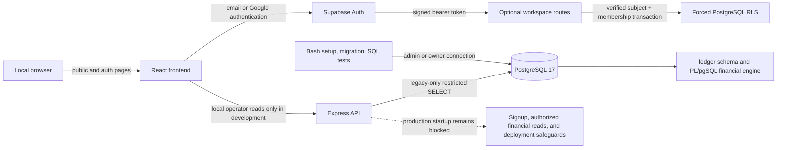

# LedgerX

LedgerX is a PostgreSQL financial ledger and reconciliation project growing into a personal, family, student, and small-business recordkeeping product. The PostgreSQL 17 financial engine remains the source of truth; the current React dashboard reads it through a small Express API.

> **Development status:** The financial database, workspace schema, PostgreSQL RLS, and a local legacy-only operator dashboard are implemented. The public site now includes email/Google sign-in screens and owner-workspace onboarding, backed by an optional Supabase JWT API boundary. No Supabase project is configured, so those account flows cannot be completed in this checkout. Authenticated financial reads are not yet connected. Production startup remains blocked. This is an educational recordkeeping project, not a payment service.

## What exists today

- PostgreSQL 17 double-entry journals, immutable posted history, idempotent posting, refunds, reversals, balance projections, settlement reconciliation, and integrity auditing.
- A React/Vite operations dashboard for transactions, accounts, ledger entries, refunds, settlements, reconciliation, and integrity findings.
- A public landing page, Supabase email/password and Google sign-in flows, email confirmation callback, adult-age attestation, and workspace-type onboarding. These flows require a configured Supabase project and an API database login; they do not use mock account data.
- An Express 5 API that serves the existing dashboard's read routes through a restricted PostgreSQL login.
- Optional Supabase JWT verification, workspace membership validation, and an idempotent authenticated workspace bootstrap route. The API role has no financial write privileges; its only write is the controlled workspace bootstrap, and it remains `NOLOGIN` until credentials are provisioned out of band.
- Docker Compose for local PostgreSQL and the API, plus SQL setup, migration, seed, test, and benchmark scripts.

The local PostgreSQL 17.12 database has 18 checksum-verified migrations applied: 4 customers, 25 accounts and balances, 68 transactions, 136 ledger entries, 68 idempotency records, 14 refunds, and 272 audit records. Migration 0012 assigned these existing records to a private legacy workspace without changing their business fields. Migrations 0014–0018 add a restricted API role, workspace bootstrap, function-grant lockdown, a narrow bootstrap visibility policy, and removal of the cross-workspace audit function from authenticated API access. The API role remains `NOLOGIN`; no API password has been configured. The separate demo workspace is empty and contains no copied legacy data.

## Architecture



The operator dashboard lives at `/operations` in the Vite development server and is excluded from production builds. Its API uses `ledgerx_dashboard`, which can read only the private legacy workspace and cannot post transactions. The public landing page is `/`; `/login`, `/signup`, and `/onboarding` use Supabase Auth and `POST /api/v1/workspaces/bootstrap` when configured. The account forms are tested but cannot be completed without real project configuration. The API still refuses `NODE_ENV=production` because financial reads are not yet tenant-authenticated.

Current routes and response shapes are documented in [the API contract](docs/api/api-contracts.md).

See [monorepo structure](docs/architecture/monorepo-structure.md), [database architecture](docs/architecture.md), [security model](docs/security-model.md), and the [data dictionary](docs/data-dictionary.md).

Tenant ownership, composite foreign keys, RLS policies, and the verified role matrix are described in [multi-tenancy](docs/database/multi-tenancy.md), [RLS security](docs/database/rls-security.md), and [workspace permissions](docs/security/role-permission-matrix.md).

## Financial integrity

- Deferred triggers enforce balanced, positive, single-currency posted journals.
- Posted journal history is append-only; corrections use compensating transactions.
- Financial operations run atomically through PL/pgSQL functions and use ordered row locks.
- Idempotency keys prevent duplicate operations and reject a reused key with a different payload.
- Account balances are projections that can be audited and rebuilt from the ledger.
- External settlement statements are stored separately from internal ledger records and reconciled through versioned runs.
- Tenant-owned rows carry an immutable workspace ID; composite foreign keys and forced RLS prevent cross-workspace references and reads when authorized context is present.

The SQL implementation and assertions remain in [`database/migrations/`](database/migrations/) and [`tests/`](tests/). See [transaction lifecycle](docs/transaction-lifecycle.md), [refund and reversal lifecycle](docs/refund-reversal-lifecycle.md), and [settlement reconciliation](docs/settlement-reconciliation.md).

## Stack

| Area | Technology |
|---|---|
| Database | PostgreSQL 17, SQL, PL/pgSQL |
| Local infrastructure | Docker Compose |
| API | Node.js 24 LTS, Express 5, `pg`, `@supabase/server`, Zod, Pino |
| Frontend | React, JavaScript, Vite, Tailwind CSS 3, React Router, Recharts, Framer Motion, Supabase JS Auth |
| Tests | SQL assertions, separate-session Bash tests, Vitest, Supertest |

Vercel, Render, Supabase Auth, and Gemini are target integrations, not configured production services yet.

## Local setup

Requirements: Docker with Compose, Node.js 24 or newer LTS, npm, Bash, and Git.

1. Create the local database settings and set private local passwords:

   ```sh
   cp .env.example .env
   ```

2. Start PostgreSQL, apply checksum-verified migrations, and load fictional reference data:

   ```sh
   scripts/setup.sh
   ```

3. Start the read-only API container:

   ```sh
   docker compose up -d --build --wait backend
   ```

4. In another terminal, prepare and run the frontend:

   ```sh
   cd frontend
   cp .env.example .env.local
   npm ci
   npm run dev
   ```

   The landing page works without Supabase configuration. `/login` and `/signup` use the project URL and publishable key in `frontend/.env.local`. To complete onboarding, set `SUPABASE_URL`, `SUPABASE_JWKS_URL`, and `AUTH_DATABASE_URL` in the ignored root `.env`, and provision a local `ledgerx_api` login. The API needs no Supabase secret key to verify JWTs. The Vite proxy defaults to `http://127.0.0.1:8080`; set `API_PROXY_TARGET` in `frontend/.env.local` if the root `.env` uses another API host port. Vite uses port 5173 when available and selects the next free port if it is occupied.

The backend can also run independently with `cd backend`, `cp .env.example .env`, `npm ci`, and `npm run dev`. Set `DATABASE_URL` to the local read-only database login; do not use the database administrator credential for the API.

To keep the database volume, stop services with `docker compose stop`. Do not use `docker compose down -v` unless you intend to delete the local database.

## Tests and measured evidence

Run the database suite from the repository root:

```sh
scripts/test.sh
```

Run application tests independently:

```sh
cd backend && npm test
cd frontend && npm test && npm run build
```

With the local API running, execute its live route smoke checks from `backend/`:

```sh
API_BASE_URL=http://127.0.0.1:8080 npm run test:api
```

Actual application, populated-database, fresh-database, RLS, and concurrency results are separated in [test results](docs/testing/test-results.md). The database benchmark plans and recorded measurements are in [`benchmarks/results/`](benchmarks/results/) with methodology in [performance analysis](docs/performance-analysis.md). The numbers are single-run query-plan observations, not production throughput claims.

## Current security and product gaps

- Supabase email login/signup, Google OAuth initiation, email confirmation callback, and browser session handling are implemented but have only been tested with mocked browser clients. No hosted Supabase project or Google provider is configured. Password recovery is not implemented. The 18+ age attestation is client-side only and is not stored as a server-side consent record; production access remains blocked.
- Workspace onboarding calls the real idempotent database bootstrap route when configured. Workspace switching/invitations and a workspace-specific financial dashboard are not implemented yet; a new user is never routed into the legacy operator data.
- The database workspace, membership, role permission, invitation, tenant ownership, composite foreign-key, and RLS layers are implemented and tested. `GET /api/v1/workspace/context` checks a JWT subject through `ledger.set_request_context`; existing financial dashboard routes are not yet workspace-authenticated.
- Existing local records remain private in the legacy workspace. The synthetic demo workspace is empty and has no public read route.
- Financial write forms, budgets, savings goals, recurring records, CSV import/export, public demo workspaces, and Gemini features are not implemented.
- Vercel and Render configuration and a controlled hosted database migration workflow are not implemented.

The implementation plan will add these in verified phases. Until identity and tenant isolation pass their security tests, do not deploy this app publicly or use local ledger records as demo data. See [known limitations](docs/known-limitations.md) and [risk register](docs/risks.md).

## Repository

```text
frontend/             React/Vite client, independently installable
backend/              Express API, independently installable
database/migrations/  PostgreSQL schema and financial operations
seeds/                Fictional local reference data
tests/                SQL assertions and concurrency fixtures
scripts/              Database setup, migration, test, demo, and benchmark runners
benchmarks/            Synthetic workloads and captured query plans
docs/                  Database engineering and product architecture notes
```

## License

See [LICENSE](LICENSE). LedgerX is an educational project, not a payment processor or a regulated financial service.
