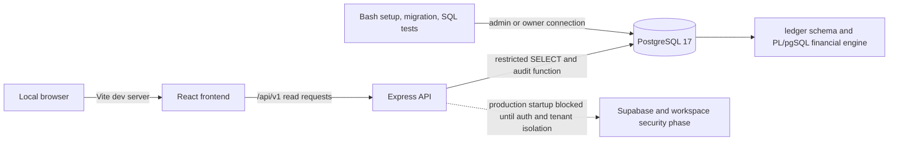

# LedgerX

LedgerX is a PostgreSQL financial ledger and reconciliation project growing into a personal, family, student, and small-business recordkeeping product. The PostgreSQL 17 financial engine remains the source of truth; the current React dashboard reads it through a small Express API.

> **Development status:** The financial database and local read-only dashboard are implemented. Authentication, workspace isolation, write APIs, public pages, AI assistance, and hosted deployment are still in progress. The current backend blocks production startup. This project is educational and must not be used to process real money.

## What exists today

- PostgreSQL 17 double-entry journals, immutable posted history, idempotent posting, refunds, reversals, balance projections, settlement reconciliation, and integrity auditing.
- A React/Vite operations dashboard for transactions, accounts, ledger entries, refunds, settlements, reconciliation, and integrity findings.
- An Express 5 API that serves the existing dashboard's read routes through a restricted PostgreSQL login.
- Docker Compose for local PostgreSQL and the API, plus SQL setup, migration, seed, test, and benchmark scripts.

The latest non-destructive repository audit found PostgreSQL 17.12 with 11 migrations applied, 25 accounts, 68 transactions, and 136 ledger entries. These are existing local records; they are not public demo data.

## Architecture



The API listens only on a loopback host address in local development and uses the database's read-only `ledgerx_dashboard` role. It cannot post transactions. The API refuses `NODE_ENV=production` until verified Supabase identity, workspace authorization, and row-level security are implemented and tested.

Current routes and response shapes are documented in [the API contract](docs/api/api-contracts.md).

See [monorepo structure](docs/architecture/monorepo-structure.md), [database architecture](docs/architecture.md), [security model](docs/security-model.md), and the [data dictionary](docs/data-dictionary.md).

## Financial integrity

- Deferred triggers enforce balanced, positive, single-currency posted journals.
- Posted journal history is append-only; corrections use compensating transactions.
- Financial operations run atomically through PL/pgSQL functions and use ordered row locks.
- Idempotency keys prevent duplicate operations and reject a reused key with a different payload.
- Account balances are projections that can be audited and rebuilt from the ledger.
- External settlement statements are stored separately from internal ledger records and reconciled through versioned runs.

The SQL implementation and assertions remain in [`database/migrations/`](database/migrations/) and [`tests/`](tests/). See [transaction lifecycle](docs/transaction-lifecycle.md), [refund and reversal lifecycle](docs/refund-reversal-lifecycle.md), and [settlement reconciliation](docs/settlement-reconciliation.md).

## Stack

| Area | Technology |
|---|---|
| Database | PostgreSQL 17, SQL, PL/pgSQL |
| Local infrastructure | Docker Compose |
| API | Node.js 24 LTS, Express 5, `pg`, Zod, Pino |
| Frontend | React, JavaScript, Vite, Tailwind CSS 3, React Router, Recharts, Framer Motion |
| Tests | SQL assertions, separate-session Bash tests, Vitest, Supertest |

Vercel, Render, Supabase Auth, and Gemini are target integrations, not configured production services yet.

## Local setup

Requirements: Docker with Compose, Node.js 24 or newer LTS, npm, Bash, and Git.

1. Create the local database settings and set private local passwords:

   ```sh
   cp .env.example .env
   ```

2. Start PostgreSQL, apply checksum-verified migrations, and load fictional reference data:

   ```sh
   scripts/setup.sh
   ```

3. Start the read-only API container:

   ```sh
   docker compose up -d --build --wait backend
   ```

4. In another terminal, install and run the frontend:

   ```sh
   cd frontend
   cp .env.example .env
   npm ci
   npm run dev
   ```

   The Vite proxy defaults to `http://127.0.0.1:8080`. If the root `.env` changes `LEDGERX_API_HOST_PORT`, set `API_PROXY_TARGET` in `frontend/.env` to that published API port. Vite uses port 5173 when available and selects the next free port if it is occupied.

The backend can also run independently with `cd backend`, `cp .env.example .env`, `npm ci`, and `npm run dev`. Set `DATABASE_URL` to the local read-only database login; do not use the database administrator credential for the API.

To keep the database volume, stop services with `docker compose stop`. Do not use `docker compose down -v` unless you intend to delete the local database.

## Tests and measured evidence

Run the database suite from the repository root:

```sh
scripts/test.sh
```

Run application tests independently:

```sh
cd backend && npm test
cd frontend && npm test && npm run build
```

With the local API running, execute its live route smoke checks from `backend/`:

```sh
API_BASE_URL=http://127.0.0.1:8080 npm run test:api
```

Actual application results and current skips are recorded in [test results](docs/testing/test-results.md). The database benchmark plans and recorded measurements are in [`benchmarks/results/`](benchmarks/results/) with methodology in [performance analysis](docs/performance-analysis.md). The numbers are single-run query-plan observations, not production throughput claims.

## Current security and product gaps

- Supabase registration, login, Google OAuth, email verification, password recovery, and session validation are not implemented.
- There is no user, workspace, membership, role, invitation, or tenant-owned financial schema yet; the existing rows have no workspace assignment.
- PostgreSQL RLS and cross-tenant isolation are not implemented. The backend is for local development only and explicitly refuses production mode.
- Financial write forms, budgets, savings goals, recurring records, CSV import/export, public demo workspaces, and Gemini features are not implemented.
- Vercel and Render configuration and a controlled hosted database migration workflow are not implemented.

The implementation plan will add these in verified phases. Until identity and tenant isolation pass their security tests, do not deploy this app publicly or use local ledger records as demo data. See [known limitations](docs/known-limitations.md) and [risk register](docs/risks.md).

## Repository

```text
frontend/             React/Vite client, independently installable
backend/              Express API, independently installable
database/migrations/  PostgreSQL schema and financial operations
seeds/                Fictional local reference data
tests/                SQL assertions and concurrency fixtures
scripts/              Database setup, migration, test, demo, and benchmark runners
benchmarks/            Synthetic workloads and captured query plans
docs/                  Database engineering and product architecture notes
```

## License

See [LICENSE](LICENSE). LedgerX is an educational project, not a payment processor or a regulated financial service.
