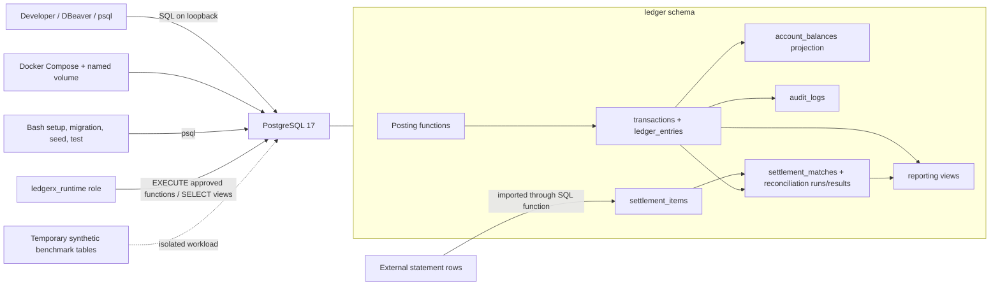
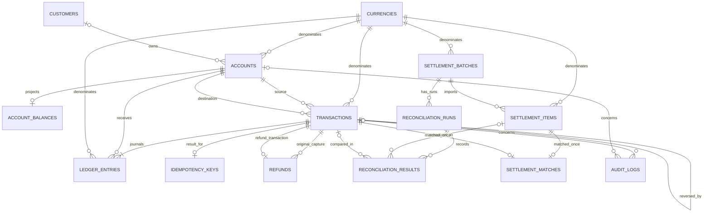
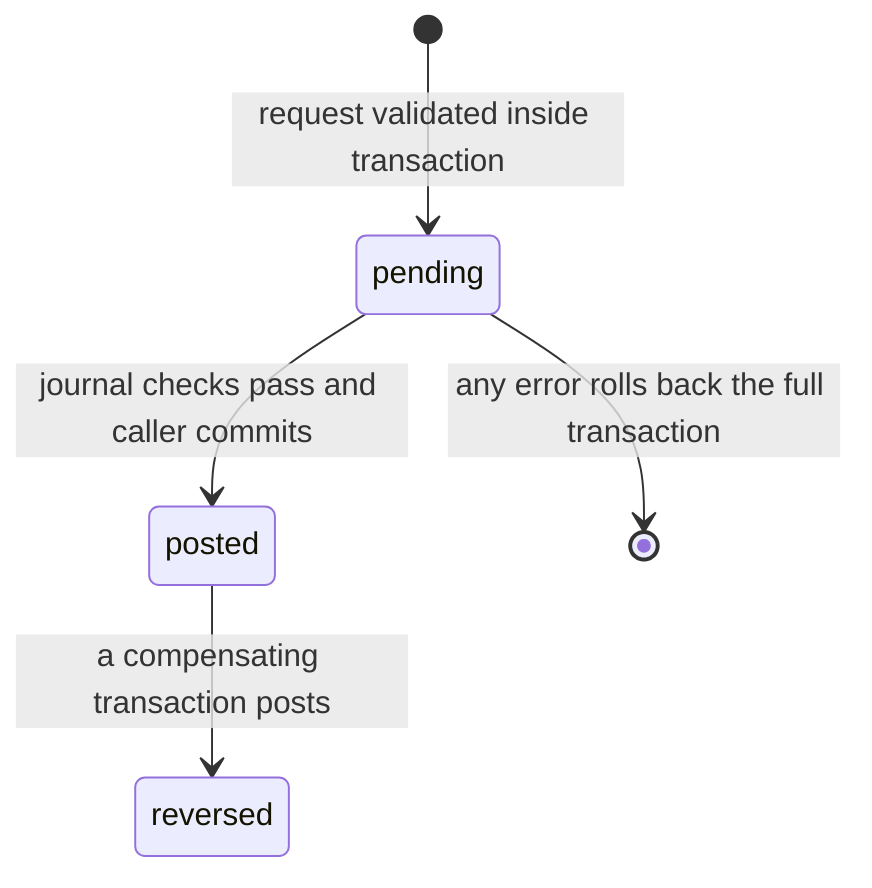

# LedgerX

**A PostgreSQL 17 financial ledger and reconciliation lab, implemented in SQL and PL/pgSQL.** LedgerX models deposits, withdrawals, transfers, merchant captures, refunds, reversals, and external settlement checks using fictional accounts.

[](https://github.com/TheLucifer-07/LEDGERX/actions/workflows/database-ci.yml)

> LedgerX is a database-only educational project. It has no payment rails, API, application server, or real customer data. It is not suitable for processing real money.

## 1. Project purpose and scope

Financial transaction systems need to preserve a trustworthy record when requests are retried, operations overlap, or external settlement files disagree with internal activity. LedgerX is a small, inspectable PostgreSQL implementation of those database problems.

The internal journal is authoritative. Every posted business operation records debit and credit lines; a separate balance projection supports guarded balance checks. Settlement files are stored as external evidence and compared with eligible internal capture and refund transactions. The project concentrates on database correctness and reproducible experiments, not on payment networks or a user-facing application.

## 2. Key engineering capabilities

- Double-entry journals with deferred, cross-row balance checks.
- Controlled posting functions for deposits, withdrawals, transfers, captures, refunds, and reversals.
- Numeric monetary values, currency-aware precision validation, and no foreign exchange.
- Append-only posted journal lines, audit records, imported statements, and reconciliation results.
- Request idempotency backed by a unique key and canonical payload hash.
- `READ COMMITTED` transaction workflows with ordered account row locks.
- Rebuildable account balance projections and an integrity auditor.
- One-to-one settlement matching with versioned reconciliation runs and exception reporting.
- Database roles that restrict runtime writes to approved functions.
- SQL assertions, separate-session concurrency checks, GitHub Actions, and measured query plans.

## 3. Technology stack

| Area | Choice |
|---|---|
| Database | PostgreSQL 17 (`postgres:17.12` in Compose) |
| Database code | SQL and PL/pgSQL |
| Local infrastructure | Docker Compose |
| Setup, migrations, tests, benchmarks | Bash and `psql` |
| CI | GitHub Actions |

There is no frontend, backend, API, ORM, or non-SQL database implementation.

## 4. System architecture



The Compose service publishes PostgreSQL only on `127.0.0.1`. The runtime role is a database boundary for learning and testing; this repository does not include a service that authenticates users or calls it. [System diagram and data flow](docs/system-architecture.md) · [Database architecture](docs/architecture.md) · [Role and trust boundaries](docs/security-model.md).

## 5. Entity relationship diagram



`account_balances` is a projection, not a second source of truth. `settlement_items` are external statement evidence; they are not journal lines. Audit `entity_id` is intentionally generic. The [detailed ER diagram](docs/er-diagram.md) lists key columns and constraints.

## 6. Database design and table overview

The `ledger` schema contains 14 base tables. Amounts use `NUMERIC(20,4)` and carry an explicit currency. Currency metadata limits accepted fractional precision; V1 does not convert currencies.

| Area | Tables | Purpose |
|---|---|---|
| Reference and accounts | `currencies`, `customers`, `accounts` | Currency rules, fictional customer records, customer and system accounts. |
| Posting | `transactions`, `ledger_entries`, `idempotency_keys`, `refunds` | Business operations, immutable journal lines, retry identity, and refund links. |
| Balance projection | `account_balances` | Transactionally maintained, rebuildable posted-balance projection. |
| External settlement | `settlement_batches`, `settlement_items`, `settlement_matches` | Batch metadata, imported statement evidence, and one-to-one matches. |
| Reconciliation | `reconciliation_runs`, `reconciliation_results` | Versioned result snapshots and detected exceptions. |
| Audit | `audit_logs` | Append-only transaction, ledger, and settlement events. |

Wallet accounts are credit-normal liabilities. Funding and payout clearing accounts are debit-normal. Deposits debit a funding account and credit a wallet; withdrawals debit a wallet and credit a payout account; transfers debit one wallet and credit another. Captures move value from a customer wallet to a merchant wallet. See the [data dictionary](docs/data-dictionary.md) and [accounting model](docs/architecture.md#accounting-model).

## 7. Transaction lifecycle



The reversal is its own posted transaction linked to the original; the original moves to `reversed`. A partial refund is also a separate linked transaction, while its capture remains posted. See the [posting sequence and transaction lifecycle](docs/transaction-lifecycle.md).

## 8. Financial integrity guarantees

- **Journal balance:** a deferred constraint trigger checks the final posted journal at commit: at least two positive lines, a single consistent currency, and equal debit and credit totals. A normal `CHECK` cannot enforce an aggregate across rows. [Trigger and function](database/migrations/0003_integrity_triggers.sql) · [schema assertions](tests/schema_integrity.sql).
- **Immutable history:** triggers reject changes to posted transaction financial fields and updates/deletes to posted ledger lines. Corrections add compensating entries. Runtime callers have no direct table-write grants. [Integrity triggers](database/migrations/0003_integrity_triggers.sql) · [financial operations](database/migrations/0004_financial_operations.sql) · [privilege and immutability tests](tests/financial_operations.sql).
- **Atomic posting:** the caller owns the PostgreSQL transaction. The operation, idempotency result, ledger lines, refund records, and balance projection changes commit or roll back together. Deferred checks run at commit. [Posting function](database/migrations/0004_financial_operations.sql).
- **Rebuildable balances:** triggers update `account_balances` in the posting transaction. The auditor compares it with posted journal activity and detects missing rows; the owner-only rebuild repopulates and rechecks the projection without editing journal history. [Auditor and rebuild](database/migrations/0006_integrity_auditor.sql) · [projection recovery](database/migrations/0010_refund_reversal_and_projection_integrity.sql) · [integrity tests](tests/integrity_auditor.sql).

## 9. Idempotency and concurrency

The unique `(scope, idempotency_key)` constraint arbitrates simultaneous retries. LedgerX stores a hash of the canonical request fields. A retry with the same hash returns the original transaction; reuse with a different payload raises an error. The deferred idempotency guard prevents a committed key from pointing to an unfinished operation. [Schema](database/migrations/0002_core_schema.sql) · [posting and final-result guard](database/migrations/0004_financial_operations.sql) · [deferred guard](database/migrations/0005_idempotency_result_guard.sql) · [tests](tests/financial_operations.sql).

Operations require `READ COMMITTED`. They lock the affected account rows in ascending account ID order with `SELECT ... FOR UPDATE`, then read the balance after any lock wait. Refunds also lock the original capture before checking the cumulative active refund amount. Stable ordering reduces deadlocks; it does not eliminate every possible deadlock, so callers must handle transaction errors. [Locking code](database/migrations/0004_financial_operations.sql) · [multi-session tests](scripts/test-concurrency.sh) and [`tests/concurrency/`](tests/concurrency/).

## 10. Refunds and reversals

Refunds apply only to posted captures. A capture may have several partial refunds, but the sum of refunds whose transactions remain `posted` cannot exceed the captured amount. Reversing a refund keeps both the refund record and its compensating journal in history; the reversed refund no longer consumes refundable capacity. A capture with an active posted refund cannot be fully reversed. V1 rejects reversing a reversal. [Refund and reversal function](database/migrations/0010_refund_reversal_and_projection_integrity.sql) · [refund history view](database/migrations/0010_refund_reversal_and_projection_integrity.sql) · [tests](tests/financial_operations.sql) · [lifecycle diagram](docs/refund-reversal-lifecycle.md).

## 11. Settlement reconciliation

External statement rows remain separate from the internal ledger. A batch has a currency and explicit half-open time window. Imported evidence is append-only; matching uses the internal transaction reference and is one-to-one. Each reconciliation run stores results for matched rows, missing internal or external records, amount or currency differences, and transaction-type mismatches. A batch closes only after the latest run has no exceptions. [Settlement functions](database/migrations/0007_settlement_reconciliation.sql) · [window rules](database/migrations/0008_settlement_windows.sql) · [tests](tests/settlement_reconciliation.sql) · [diagram](docs/settlement-reconciliation.md).

## 12. Testing methodology and actual results

Run `scripts/test.sh` to apply or verify migrations and execute seven SQL/Bash suites. Assertions use `ON_ERROR_STOP`; business-path fixtures usually roll back. The separate-session concurrency suite commits demonstration transactions but restores its fixture wallet balances, so the test history is not empty afterward. Use a disposable local database if you need a clean history.

**Most recent recorded local run:** 2026-11-14, `scripts/test.sh` exited 0 against PostgreSQL 17.12. All seven groups passed: schema and deferred journal checks; financial operations, idempotency, rollback, and privileges; auditor and projection recovery; settlement; reporting; concurrent withdrawals, reverse-direction transfers, same-key retries, and refund cap; migration checksum rejection. The local concurrency run observed the expected lock waits, and the fixture balances were restored. See [test scripts](scripts/test.sh) and the [execution record](docs/testing-strategy.md).

**GitHub Actions:** [Database CI run #2](https://github.com/TheLucifer-07/LEDGERX/actions/runs/43577577172) completed successfully on 2026-11-14 for commit `76ee06e`. That run predates this documentation-only working-tree update; it does not verify these unpushed edits. The workflow is [`.github/workflows/database-ci.yml`](.github/workflows/database-ci.yml).

**Not independently verified:** all possible transaction schedules, production failover and restore behavior, payment networks, crash recovery, and the unpushed documentation changes. The test suite is a targeted local verification set, not a production certification.

## 13. Performance benchmarks with measured values

These are actual single-run `EXPLAIN (ANALYZE, BUFFERS)` query-plan observations on PostgreSQL 17.12, Apple Silicon, using temporary synthetic tables. The query returns one account’s activity and running balance while two-line transaction and entry tables grow. It compares the same query before and after an `(account_id, transaction_id)` index on the temporary entry table.

| Synthetic transactions | Ledger lines | Before index | After index |
|---:|---:|---:|---:|
| [1,000](benchmarks/results/account-activity-1000.txt) | 2,000 | 0.215 ms | 0.138 ms |
| [100,000](benchmarks/results/account-activity-100000.txt) | 200,000 | 13.693 ms | 8.433 ms |
| [1,000,000](benchmarks/results/account-activity-1000000.txt) | 2,000,000 | 133.464 ms | 90.195 ms |

Plans, PostgreSQL version, row generation, and buffer counts are preserved in [`benchmarks/results/`](benchmarks/results/); methodology and interpretation are in [performance analysis](docs/performance-analysis.md). Each scale is a single observed run without controlled warm-up or repeated percentiles. The index is on temporary benchmark data; these numbers are not transaction throughput claims or proof that a production index should be added.

Reproduce a scale with `scripts/benchmark.sh 1000`, `scripts/benchmark.sh 100000`, or `scripts/benchmark.sh 1000000`. Results are host- and cache-dependent.

## 14. Local setup instructions

Requirements: Docker with Compose, Bash, and Git. A host PostgreSQL installation is not needed.

```sh
test -f .env || cp .env.example .env
# Edit .env and set POSTGRES_PASSWORD to a private local value.
scripts/setup.sh
```

The setup starts the pinned PostgreSQL 17 container, waits for health, applies numbered checksum-verified migrations, and loads fictional reference data. Re-running setup verifies migration checksums and retains the named database volume.

```sh
scripts/test.sh
scripts/demo.sh
```

The test suite leaves its documented concurrency demonstration history. `scripts/demo.sh` runs the end-to-end walkthrough inside a transaction that rolls back its writes. To stop PostgreSQL and keep the database, run `docker compose stop`. `docker compose down -v` deletes the local volume and all its data; run it only when you intend to remove that database.

## 15. DBeaver connection instructions

Create a PostgreSQL connection with:

| Setting | Value |
|---|---|
| Host | `127.0.0.1` |
| Port | `55432` |
| Database | `ledgerx` |
| Username | `ledgerx_admin` |
| Password | The local `POSTGRES_PASSWORD` value in the ignored `.env` file |
| SSL | Disabled for this loopback-only local Compose connection |

Choose **Test Connection**. After connecting, expand the `ledger` schema. The local admin account is for this development database; hosted/runtime deployments should use a separately provisioned restricted login. See [security model](docs/security-model.md).

## 16. Repository structure

```text
database/migrations/  Ordered schema and business-logic migrations, with learning notes
seeds/                Fictional currencies, customers, system accounts, and wallets
tests/                SQL assertions and independent-session concurrency fixtures
scripts/              Setup, migration, seed, test, demo, and benchmark runners
benchmarks/           Synthetic workload, captured EXPLAIN plans, and measurements
docs/                 Architecture, decisions, lifecycle, limits, testing, and guides
docs/screenshots/      Instructions for adding genuine local execution captures
examples/              Rollback-only end-to-end SQL walkthrough
.github/workflows/    PostgreSQL 17 database CI
```

## 17. Known limitations

- No external payment rails, online customer identity, payment API, or service layer.
- No FX, fees, taxes, chargebacks, split settlement, or many-to-one settlement matching.
- Imported settlement evidence is append-only; V1 has no batch reopen or corrected-import workflow.
- Rejected requests roll back; durable failed-request analytics are out of scope.
- A transaction can be reversed only once; reversals of reversals are rejected.
- Compose uses a local superuser credential and does not configure TLS; this is not a hosted deployment pattern.
- Selected concurrency races are tested locally; the suite does not prove correctness for every possible schedule.
- Benchmarks are isolated synthetic query-plan experiments, not end-to-end or production throughput tests.
- Backups, restore drills, high availability, retention policy, and independent security review are not implemented.

See [known limitations](docs/known-limitations.md) and the [risk register](docs/risks.md).

## 18. Educational-use disclaimer

LedgerX is for database engineering education and review. It has not received independent financial security, regulatory, or compliance certification. Do not use it to process real financial transactions or store sensitive personal or payment-card data.

## 19. MIT license

LedgerX is distributed under the [MIT License](LICENSE). Copyright belongs to Hema Chandu Animireddy.
