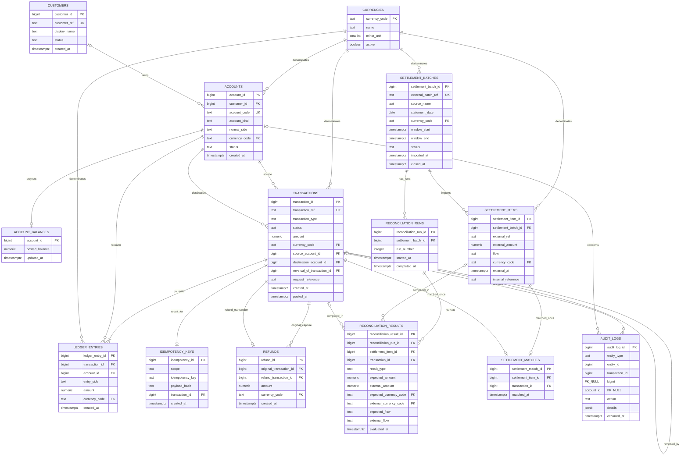

# LedgerX entity relationship diagram

The diagram represents the 14 base tables in the current migrations. Optional account ownership supports system clearing accounts. `account_balances` is a derived projection. Settlement statement lines and reconciliation snapshots remain separate from posted internal journals.

## Relationship and integrity notes

- Each account has a projection row created by an account trigger. The auditor detects a missing row and the owner-only rebuild can restore it; the projection is therefore a maintained invariant, not the source of truth.
- Transaction source and destination accounts are explicit foreign keys. Self-transfers are prohibited by a check constraint.
- Every committed posted transaction created through the controlled functions has a completed idempotency result. A unique constraint on `(scope, idempotency_key)` serializes retries; the transaction result reference is also unique.
- A journal has two or more positive lines. A deferred constraint trigger checks one-currency debit/credit equality at commit.
- `reversal_of_transaction_id` is unique, allowing at most one full reversal per original transaction. Reversal rows are themselves transactions with compensating journal lines.
- `settlement_items.internal_reference` is a statement-supplied reference, not a foreign key. It is matched against a posted capture/refund transaction reference during reconciliation.
- Unique constraints on each side of `settlement_matches` enforce one-to-one matching. Result rows may reference an external item, an internal transaction, or both; the result snapshot is append-only.
- `audit_logs.entity_id` is intentionally generic and is not a foreign key. Typed optional transaction/account references are retained where available.

## SQL source

- [Core tables and constraints](../database/migrations/0002_core_schema.sql)
- [Posting, ledger, and audit triggers](../database/migrations/0003_integrity_triggers.sql)
- [Settlement and reconciliation additions](../database/migrations/0007_settlement_reconciliation.sql)
- [Explicit settlement window](../database/migrations/0008_settlement_windows.sql)
- [Projection and refund history additions](../database/migrations/0010_refund_reversal_and_projection_integrity.sql)
