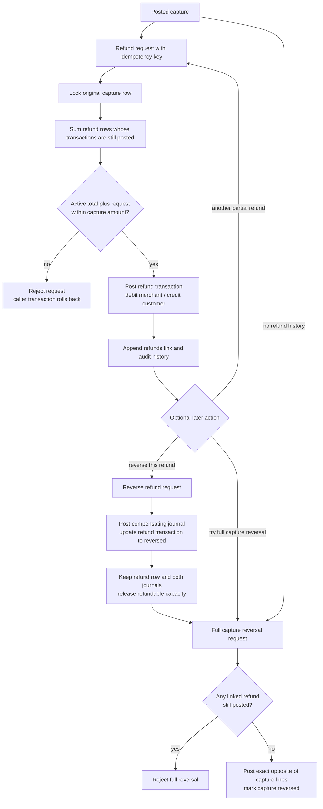

# Refund and reversal lifecycle

Refunds are new postings linked to a posted capture; they never edit or delete the capture journal. A refund is permitted only while the sum of refund transactions that remain `posted` stays within the original capture amount.

Each refund is a separate transaction and can be reversed independently. A reversed refund remains visible in history but no longer counts against the capture's refundable amount. A capture with any active posted refund cannot be fully reversed. A reversal of a reversal is rejected in V1.

## SQL and test references

- [Refund cap, original-transaction locking, and compensating journals](../database/migrations/0004_financial_operations.sql)
- [Active-refund semantics, reversal integrity checks, and refund history view](../database/migrations/0010_refund_reversal_and_projection_integrity.sql)
- [Refund, cap, reversal, and retry assertions](../tests/financial_operations.sql)
- [Concurrent refund cap scenario](../tests/concurrency/refund_a.sql) and [competing request](../tests/concurrency/refund_b.sql)
- [Test runner](../scripts/test-financial.sh) and [concurrency runner](../scripts/test-concurrency.sh)
