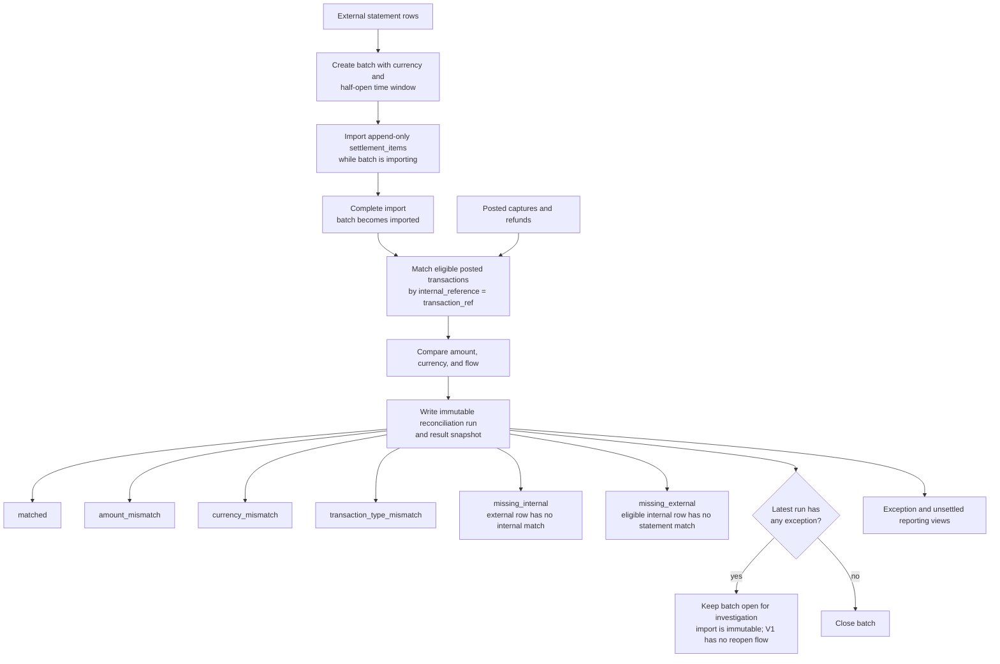

# Settlement reconciliation lifecycle

Settlement records preserve two separate sources: posted internal captures/refunds and imported external statement rows. Importing a statement does not create or modify a journal entry. Matching first uses the supplied internal transaction reference; amount, currency, and flow comparisons then classify the match.

Only importing batches accept new evidence. Imported rows and reconciliation results are append-only. Each external item and each internal transaction can be matched at most once. A batch can close only when its latest reconciliation run has no non-matched result. Re-running a closed batch can record a new result snapshot, but does not add new matches or statement lines.

The settlement window is `[window_start, window_end)`. Internal unmatched reporting considers posted captures/refunds in the batch currency whose `posted_at` falls inside that interval. `ledger.v_unsettled_transactions` is a separate read-only view of eligible internal transactions without a settlement match.

## SQL and test references

- [Settlement tables and constraints](../database/migrations/0002_core_schema.sql)
- [Import, match, reconcile, close, and audit functions](../database/migrations/0007_settlement_reconciliation.sql)
- [Window-scoped eligibility](../database/migrations/0008_settlement_windows.sql)
- [Exception and unsettled reporting views](../database/migrations/0009_reporting_views.sql)
- [Settlement assertions](../tests/settlement_reconciliation.sql) · [runner](../scripts/test-settlement.sh)
- [Reporting assertions](../tests/reporting_views.sql)
