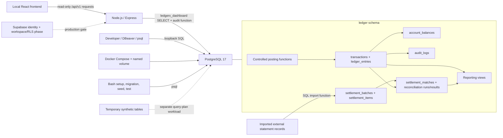

# System architecture

LedgerX's PostgreSQL 17 ledger remains the financial source of truth. The current local app has an independently installable React/Vite frontend and Node/Express read API. The API uses the restricted `ledgerx_dashboard` login; it does not post or alter financial records. It is unauthenticated and intentionally refuses production startup until Supabase authentication, workspace authorization, and PostgreSQL RLS are implemented.

Compose exposes PostgreSQL and the API on loopback host ports and keeps files in a named database volume. Local Compose uses `ledgerx_admin` to initialize and inspect the database; the API uses `ledgerx_dashboard`, whose default transactions are read-only. This is a learning setup, not a public deployment security model. Current local records have not been assigned to a workspace.

## Data flow

1. Numbered SQL migrations create roles, schema objects, triggers, functions, and views. The migration runner records SHA-256 checksums in `public.ledgerx_schema_migrations` in the migration transaction.
2. Fictional reference data creates currency, customer, clearing, merchant, and wallet records.
3. SQL callers and database tests invoke a `ledger` posting function in a PostgreSQL transaction. It validates the request, claims its idempotency key, locks accounts, appends journal lines, and updates the balance projection atomically. The current web API has no write endpoint.
4. Deferred checks validate final journal state when the caller commits. The audit table records relevant changes; posted journal entries remain immutable.
5. Settlement statement rows are imported into their own tables. Reconciliation records matches and exception snapshots without rewriting ledger activity.
6. The Express API runs parameterized queries and approved read-only views/functions for the dashboard. No user or workspace is established yet.

Benchmarks use temporary tables in a separate `psql` session. They do not add synthetic rows to financial tables.

## Main SQL references

- [Migration runner](../scripts/migrate.sh) and [local setup](../scripts/setup.sh)
- [Core schema](../database/migrations/0002_core_schema.sql)
- [Journal guards and projection maintenance](../database/migrations/0003_integrity_triggers.sql)
- [Posting functions](../database/migrations/0004_financial_operations.sql)
- [Settlement functions](../database/migrations/0007_settlement_reconciliation.sql)
- [Reporting views](../database/migrations/0009_reporting_views.sql)
- [Docker Compose configuration](../docker-compose.yml)
- [Express API routes and contract](api/api-contracts.md)
- [Monorepo boundary and phase status](architecture/monorepo-structure.md)
- [Current application test evidence](testing/test-results.md)
