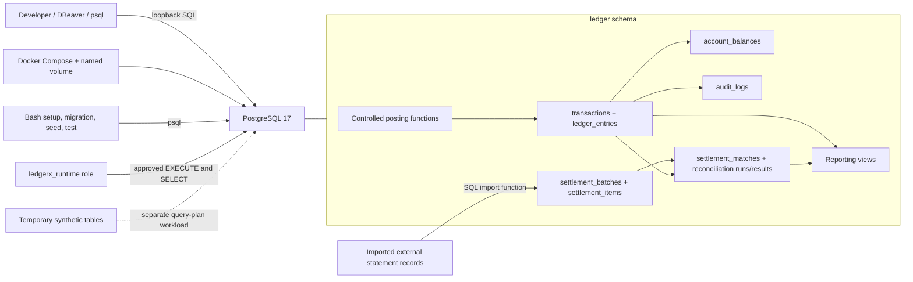

# System architecture

LedgerX is a PostgreSQL database project with a local Compose service. There is no application server or payment API. A developer or SQL caller invokes the database functions directly; the Bash scripts run `psql` for setup, migrations, seeds, assertions, and isolated benchmarks.

Compose exposes PostgreSQL on `127.0.0.1` only and keeps files in a named volume. The runtime group is `NOLOGIN`; a real caller would receive membership through a separately provisioned login. Local Compose uses `ledgerx_admin` to initialize and inspect the database. It is a learning setup, not a deployment security model.

## Data flow

1. Numbered SQL migrations create roles, schema objects, triggers, functions, and views. The migration runner records SHA-256 checksums in `public.ledgerx_schema_migrations` in the migration transaction.
2. Fictional reference data creates currency, customer, clearing, merchant, and wallet records.
3. A caller invokes a `ledger` posting function in a PostgreSQL transaction. It validates the request, claims its idempotency key, locks accounts, appends journal lines, and updates the balance projection atomically.
4. Deferred checks validate final journal state when the caller commits. The audit table records relevant changes; posted journal entries remain immutable.
5. Settlement statement rows are imported into their own tables. Reconciliation records matches and exception snapshots without rewriting ledger activity.
6. Read-only reporting views expose activity, period totals, refunds, settlements, exceptions, and unsettled transactions.

Benchmarks use temporary tables in a separate `psql` session. They do not add synthetic rows to financial tables.

## Main SQL references

- [Migration runner](../scripts/migrate.sh) and [local setup](../scripts/setup.sh)
- [Core schema](../database/migrations/0002_core_schema.sql)
- [Journal guards and projection maintenance](../database/migrations/0003_integrity_triggers.sql)
- [Posting functions](../database/migrations/0004_financial_operations.sql)
- [Settlement functions](../database/migrations/0007_settlement_reconciliation.sql)
- [Reporting views](../database/migrations/0009_reporting_views.sql)
- [Docker Compose configuration](../docker-compose.yml)
