# Transaction lifecycle

The caller controls `BEGIN` and `COMMIT`. Posting functions run inside that transaction and do not commit on the caller's behalf.

```mermaid
stateDiagram-v2
    [*] --> pending: request validated in transaction
    pending --> posted: journal checks pass and caller commits
    pending --> [*]: any operation or deferred check fails; rollback
    posted --> reversed: a separate compensating transaction posts
```



The committed state does not retain failed transaction rows. A successful reversal creates a second transaction whose `reversal_of_transaction_id` references the original. The original status changes to `reversed`; its journal remains unchanged. Partial refunds are separate linked transactions and do not change the capture's status.

## Posting sequence

```mermaid
sequenceDiagram
    actor Caller
    participant DB as PostgreSQL function
    participant I as idempotency_keys
    participant A as accounts and account_balances
    participant T as transactions
    participant L as ledger_entries

    Caller->>DB: BEGIN; invoke operation(key, payload)
    DB->>I: insert scope, key, canonical payload hash
    alt key already belongs to a concurrent or earlier request
        I-->>DB: unique-index conflict waits for owner
        DB->>I: read committed hash and transaction result
        alt same payload hash
            DB-->>Caller: return original transaction ID
        else changed payload
            DB-->>Caller: raise key-reuse error
        end
    else new key claimed
        DB->>A: lock touched accounts in ascending ID order
        DB->>A: validate status, currency, and available balance
        DB->>T: insert pending transaction header
        DB->>L: append positive debit and credit lines
        DB->>A: update balance projection in same transaction
        DB->>T: transition header to posted
        Caller->>DB: COMMIT
        DB->>L: deferred trigger checks final journal
        alt trigger or operation fails
            DB-->>Caller: error; full transaction rolls back
        else all constraints pass
            DB-->>Caller: committed transaction reference
        end
    end
```

## Isolation and locking

Operation functions require PostgreSQL `READ COMMITTED`. They acquire affected account rows with `SELECT ... FOR UPDATE`, ordered by ascending `account_id`, and then read the balance in a later statement so it sees the result of any transaction waited on. For refund caps, the function also locks the original capture before summing refund transactions that remain posted. Those locks serialize withdrawals and refunds that compete for the same account or capture.

An error before commit rolls back the idempotency claim, transaction header, ledger entries, refund row, audit changes, and projection changes together. Deferred constraint triggers run at commit and abort the same transaction on an invalid final journal. Deadlocks are still possible across more complex paths; callers must handle a rolled-back transaction and retry only with a bounded policy.

## Accounting treatment

All journal amounts are positive and have an explicit debit/credit side. Wallets are credit-normal liabilities; system funding and payout clearing accounts are debit-normal assets.

| Operation | Debit | Credit |
|---|---|---|
| Deposit | Funding clearing | Customer wallet |
| Withdrawal | Customer wallet | Payout clearing |
| Transfer | Sender wallet | Recipient wallet |
| Capture | Customer wallet | Merchant wallet |
| Refund | Merchant wallet | Customer wallet |
| Reversal | Opposite side for every original line | Compensating side for every original line |

Every posted journal must contain at least two lines, one currency, and equal debit and credit totals. Cross-row totals are enforced at commit by a deferred constraint trigger, not an ordinary `CHECK`.

## SQL and test references

- [Core transaction and ledger tables](../database/migrations/0002_core_schema.sql)
- [Deferred journal check, immutability, audit, and balance updates](../database/migrations/0003_integrity_triggers.sql)
- [Deposit, withdrawal, transfer, capture, refund, and reversal functions](../database/migrations/0004_financial_operations.sql)
- [Final idempotency result guard](../database/migrations/0005_idempotency_result_guard.sql)
- [Schema and journal assertions](../tests/schema_integrity.sql)
- [Financial, retry, rollback, and privilege assertions](../tests/financial_operations.sql)
- [Independent-session concurrency scenarios](../scripts/test-concurrency.sh)
