# Transaction Lifecycle

## Business transaction state

```mermaid
stateDiagram-v2
    [*] --> pending: request validated / idempotency claimed
    pending --> posted: journal appended and deferred checks pass at COMMIT
    pending --> [*]: any error raises; full transaction rolls back
    posted --> reversed: full compensating journal posts
    posted --> posted: partial refund posts as a separate linked transaction
    reversed --> [*]
```



Rejected requests raise and roll back; V1 does not create failed transaction rows or durable failed-request analytics. `reversed` denotes the original transaction's lifecycle view; the reversal itself is a distinct posted transaction linked through `reversal_of_transaction_id`. A capture with an active posted refund cannot transition to reversed.

## Posting sequence

```mermaid
sequenceDiagram
    actor Client
    participant DB as PostgreSQL function
    participant I as idempotency_keys
    participant A as accounts / account_balances
    participant T as transactions
    participant L as ledger_entries

    Client->>DB: BEGIN; call operation(key, canonical payload)
    DB->>I: INSERT unique (scope,key), hash, pending result
    alt another request owns same key
        I-->>DB: unique conflict waits, then existing row
        DB->>I: compare payload hash
        alt same payload
            DB-->>Client: original transaction result
        else different payload
            DB-->>Client: reject key reuse
        end
    else key claimed
        DB->>A: lock all touched accounts in ascending ID order
        DB->>A: validate status/currency/balance after lock
        DB->>T: insert pending transaction
        DB->>L: append all positive debit/credit lines
        DB->>A: update normalized balance projection atomically
        DB->>T: transition to posted
        Client->>DB: COMMIT
        DB->>L: deferred trigger checks final journal balance/count/currency
        alt any validation or deferred invariant fails
            DB-->>Client: error; full transaction rolls back
        else checks pass
            DB-->>Client: committed transaction reference
        end
    end
```

The caller owns `BEGIN`/`COMMIT`; PL/pgSQL functions do not commit. A same-key concurrent call may block on the unique index until the owner commits or rolls back. The retry then sees the completed original result, or can claim the key if the first owner rolled back. Only an exact canonical payload match is a retry.

## Reversal and refund sequence

Full reversal creates a new transaction with opposite-side lines for every original line, links it to the original, and is unique per original. Partial/full refund creates a separate compensating transaction for a capture, locks the original before summing refund rows whose linked refund transactions remain `posted`, and rejects any amount that would take the active cumulative total above the capture. Reversing a refund creates another compensating journal and changes the refund transaction to `reversed`; its `refunds` row remains available in `v_refund_history`. The reversed amount is released for a later refund and no longer blocks capture reversal. Reversing a reversal is rejected in V1. Refunds are not silently folded into edits of the original journal.
